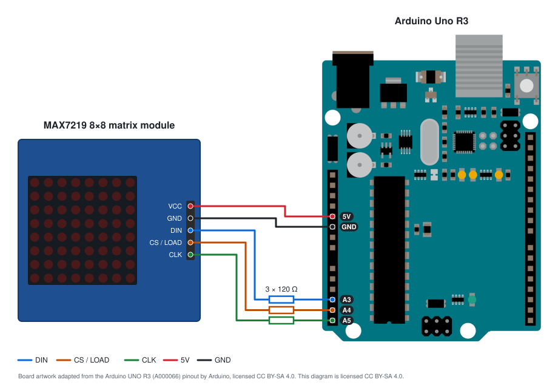

# Matrix Marquee

A small AVR firmware project that scrolls a message across an 8×8
MAX7219-compatible LED matrix. It targets the ATmega328P on an Arduino Uno R3.

## Hardware

Connect the matrix to the Arduino Uno R3 as shown below. DIN, CS / LOAD and
CLK go to A3, A4 and A5 (PC3–PC5 on the ATmega328P), each through a 120 Ω
series resistor:



Place the resistors close to the Arduino end of the wires. They limit the
current into the signal lines and damp ringing on fast edges, which matters
with long jumper wires.

The firmware sends commands to the MAX7219 by toggling GPIO pins in software
(bit-banging) rather than through the ATmega328P's hardware SPI. On the Uno,
hardware SPI is fixed to D10 (SS), D11 (MOSI) and D13 (SCK), and D13 also
drives the on-board L LED. Bit-banging lets the matrix use any free pins, and
it is fast enough here: each scroll step sends 18 short commands, which takes
well under a millisecond. A4 and A5 are the Uno's I²C pins, but the firmware
uses them as plain GPIO.

The L LED pin (D13 / PB5) is set as an output and kept low, so the LED stays
off.

## Requirements

- An Arduino Uno R3 connected over USB
- Docker, or a native AVR toolchain: `avr-gcc`, `avr-libc`, `avrdude` and
  `make` (Debian/Ubuntu: `apt install gcc-avr avr-libc avrdude make`;
  Fedora: `dnf install avr-gcc avr-libc avrdude make`)

## Build and flash

From the repository root:

```sh
make          # build main.hex
make size     # report flash and RAM usage
make flash    # upload through the Uno bootloader
```

With Docker, prefix the commands with `tools/avr` to run them inside a
container. The image is built from
[`.devcontainer/Dockerfile`](.devcontainer/Dockerfile) on first use.

```sh
tools/avr make flash
```

The default upload port is `/dev/ttyACM0`. Set `AVR_PORT` to use another:

```sh
AVR_PORT=/dev/ttyUSB0 make flash
```

On Linux, flashing natively requires access to the serial device (usually
membership in the `dialout` or `uucp` group).

## Configuration

Settings live in [`src/config.h`](src/config.h). Rebuild and flash after
changing them.

| Setting | Effect |
| --- | --- |
| `MESSAGE_TEXT` | Text to scroll; printable ASCII only |
| `MESSAGE_FALLBACK_CHAR` | Shown in place of characters the font lacks |
| `DISPLAY_INTENSITY_LEVEL` | Brightness, from `0x00` (dimmest) to `0x0F` (brightest) |
| `STARTUP_DELAY_MS` | Time the display stays dark after power-on |
| `LIT_PHASE_MS` | Time each scroll step is shown |
| `DARK_PHASE_MS` | Time the display is blanked between steps |

The text advances one column every `LIT_PHASE_MS + DARK_PHASE_MS`, which
can be at most 100 ms. Raise either value to scroll more slowly, or lower them
to scroll faster. The dark gap keeps moving edges from looking doubled. A
longer lit phase makes the text brighter, but it also makes the blur more
noticeable.

The `MAX7219_*_CYCLES` values set the bit-banged signal timing. Leave them
alone unless the display misbehaves, for example with garbled or missing
columns. Tuning them needs an oscilloscope to check the signals against the
MAX7219 datasheet.

## AI assistance

AI tools were used to help refactor the code, write documentation and polish
the project.

## License

This project is available under the [MIT License](LICENSE), except
`assets/wiring.svg`, which adapts Arduino's
[UNO R3 pinout](https://docs.arduino.cc/hardware/uno-rev3/) artwork and is
licensed [CC BY-SA 4.0](https://creativecommons.org/licenses/by-sa/4.0/).
